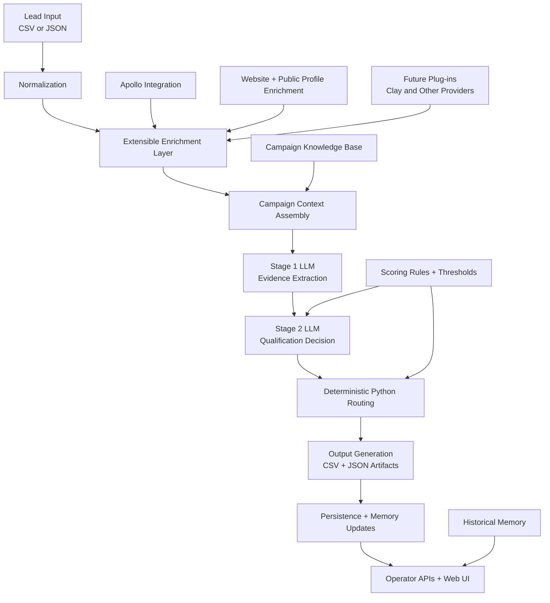
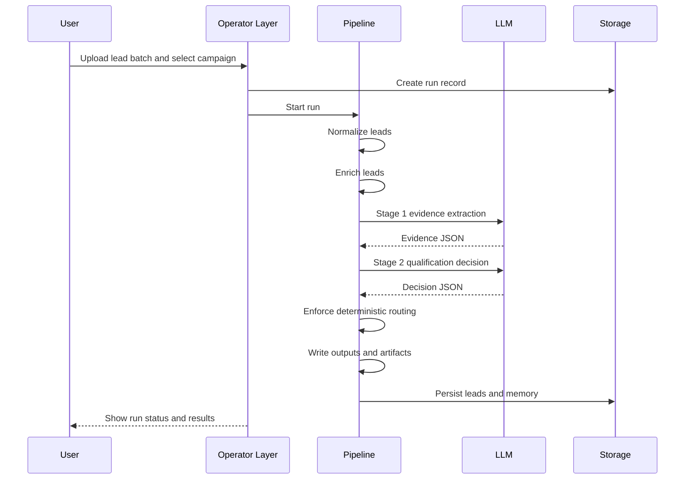

# Cortex  Architecture&#x20;

## Purpose

This document explains the architecture of the lead generation engine as a complete system.

The platform is designed to turn noisy outbound lead signals into a ranked, auditable, campaign-aware decision workflow. It combines deterministic Python orchestration, lightweight enrichment, two-stage LLM reasoning, authoritative routing rules, persistent memory, and an operator-facing web layer.

At a high level, the system is built around one core principle:

> The LLM is the reasoning engine. Python is the control plane.

That means the model is responsible for interpretation and scoring suggestions, while the application remains responsible for workflow, validation, routing, storage, auditability, and safety.

***

## Executive Summary

The system has five major layers:

1. Input and normalization
2. Enrichment and context assembly
3. Two-stage LLM reasoning
4. Deterministic routing and output generation
5. Persistence, memory, and operator workflows

These layers work together to support two complementary operating models:

- a batch lead qualification pipeline for uploaded CSV or JSON lead sets
- an interactive operator platform for profiling, review, campaign management, and historical memory access

The result is a hybrid architecture that is neither a pure rules engine nor a pure autonomous agent. It is a controlled reasoning platform with explicit guardrails.

***

## System Overview



The architecture separates concerns very deliberately:

- normalization makes raw data usable
- enrichment adds external, heuristic, and provider-based context
- campaign context supplies business rules
- Stage 1 extracts evidence
- Stage 2 converts evidence into scored judgment
- deterministic routing enforces authoritative outcomes
- persistence keeps every run inspectable and reusable

***

## Architectural Principles

### 1. Separation Of Reasoning And Control

The platform does not allow the model to control the workflow. The model returns structured outputs, but the application governs:

- orchestration
- retries
- timeouts
- score integrity
- routing authority
- artifact writing
- persistence
- campaign activation

This reduces the risk of hidden behavior drift and makes the system easier to debug.

### 2. Evidence Before Decision

The reasoning process is intentionally split into two steps:

- Stage 1 asks: "What do we know?"
- Stage 2 asks: "Given what we know, how should we score this lead?"

This separation improves:

- explainability
- prompt discipline
- decision consistency
- calibration
- forensic review of false positives and false negatives

### 3. Campaign Context Is Externalized

Product knowledge, ICP rules, disqualifiers, and qualification logic are managed as campaign assets rather than hard-coded into the scoring flow.

This allows the same engine to support multiple products or go-to-market motions while preserving campaign-specific logic.

### 4. Policy Is Controlled, Memory Is Additive

The system is designed so that:

- memory can grow automatically
- policy cannot change silently

Historical knowledge may help future workflows, but thresholds, disqualification rules, scoring weights, and activation status remain explicitly controlled.

### 5. Auditability Is A First-Class Requirement

Every processed lead should be reconstructable through stored artifacts and persistent records. The system is built to support review, calibration, and debugging, not just final output.

***

## Layered Architecture

## 1. Input Layer

The system accepts lead batches in structured formats such as CSV and JSON.

This layer is responsible for:

- receiving uploaded lead datasets
- identifying format
- preparing batches for downstream processing
- supporting both operator-triggered and direct run execution

The input layer is intentionally simple. It does not try to reason about lead quality. Its role is to get data into the pipeline in a controlled way.

## 2. Normalization Layer

The normalization layer transforms noisy raw lead data into a consistent internal schema.

Its responsibilities include:

- field validation
- text cleanup
- domain normalization
- LinkedIn URL cleanup
- title standardization
- duplicate filtering
- invalid row rejection without failing the entire run

This layer protects every downstream component from format noise and malformed records.

Without this step, enrichment quality, LLM outputs, and routing decisions would become inconsistent.

## 3. Enrichment Layer

Once a lead is normalized, the system enriches it with additional context.

Enrichment combines:

- structured provider-based enrichment through Apollo
- website summarization
- public profile summarization
- role seniority heuristics
- recent signal extraction where available

The enrichment layer is intentionally extensible.

Today, Apollo acts as the primary structured enrichment provider and supplies company-level context such as firmographic and commercial signals when available.

Over time, this same layer can support additional plug-in providers without changing the overall architecture. For example, Clay can be introduced later as another enrichment source for structured firmographic, contact, intent, or workflow-specific data.

This means enrichment should be understood as a provider abstraction layer rather than a single hard-wired integration.

This layer is best-effort by design. The system continues even when external enrichment is partial or missing.

The purpose of enrichment is not to replace reasoning. It is to give the reasoning engine a richer factual base.

## 4. Campaign Context Layer

The campaign context layer assembles the business logic that defines what "good" means for a given campaign.

Campaign context typically includes:

- product positioning
- ideal customer profile
- target personas
- signal interpretation rules
- qualification criteria
- disqualification rules
- scoring configuration
- thresholds

This layer is what makes the engine campaign-aware rather than globally generic.

Conceptually, the campaign context acts as a policy package injected into the reasoning stages.

## 5. Reasoning Layer

The reasoning layer uses a two-stage LLM flow.

### Stage 1: Evidence Extraction

The first stage analyzes the normalized and enriched lead and produces a structured evidence object.

Typical outputs include:

- segment classification
- possible use case
- signal strength
- observed evidence
- inferred evidence
- unknowns
- hard disqualifiers

This stage is explicitly not allowed to make the final qualification call.

Its only job is to extract and structure the evidence base.

### Stage 2: Qualification Decision

The second stage receives only the Stage 1 evidence object.

It then produces:

- decision suggestion
- total score
- factor-level sub-scores
- confidence level
- qualification reasons
- disqualification reasons
- short reasoning summary
- suggested use case

Because Stage 2 works from structured evidence rather than raw input, the system keeps the scoring task narrower and more disciplined.

## 6. Deterministic Control Layer

This is the trust layer of the system.

After the model returns a decision object, the application performs deterministic enforcement such as:

- sub-score clamping
- score recomputation
- threshold alignment
- hard disqualifier overrides
- low-signal overrides
- final authoritative routing

This layer ensures that final outcomes always follow the platform's explicit rules, even if the model output is imperfect.

The platform therefore treats model output as a structured proposal, not as the final source of truth.

## 7. Output Layer

Once routing is finalized, the system writes:

- queue-oriented CSV outputs for qualified, review, and disqualified leads
- per-lead JSON artifacts for audit and inspection
- run logs

This layer serves both operational and analytical purposes.

Operationally, it creates action queues.

Analytically, it preserves exactly what entered the pipeline, what was inferred, what was scored, and how the final routing was determined.

## 8. Persistence And Memory Layer

The persistence layer stores both run results and longer-lived memory.

It supports:

- run metadata
- scored lead results
- campaign metadata
- exclusions
- templates
- company profiles
- person profiles
- append-only lead memory
- human review feedback
- campaign versions
- policy versions

This layer turns the engine from a stateless batch tool into an accumulating outbound intelligence system.

## 9. Operator And API Layer

The operator layer exposes the system through a web interface and service endpoints.

It supports workflows such as:

- uploading new lead batches
- monitoring live run progress
- reviewing scored leads
- inspecting artifacts
- profiling companies
- profiling people
- evaluating fit on demand
- recording review feedback
- managing campaign versions
- managing policy versions
- exporting downstream actions

This layer is the human-facing control plane for the platform.

***

## End-To-End Processing Flow

## Batch Qualification Flow



## Interactive Profiling Flow

The system also supports entity-level evaluation outside a batch upload.

In this mode:

1. an operator provides a company, person, or both
2. the platform builds a synthetic lead context
3. normalization and enrichment run as usual
4. the two-stage reasoning process runs
5. deterministic routing finalizes the verdict
6. historical memory may be retrieved to support interpretation

This makes the same scoring kernel reusable for interactive account research and fit assessment.

***

## Component Responsibilities

## Ingestion And Run Management

Responsibilities:

- receive uploads
- create run records
- isolate run state
- stream progress
- trigger batch execution

## Normalization

Responsibilities:

- transform raw lead formats into one schema
- clean and standardize fields
- reject invalid records safely
- deduplicate leads

## Enrichment

Responsibilities:

- gather auxiliary firmographic and profile data
- summarize public sources
- derive lightweight local heuristics
- fail gracefully when data is sparse

## Campaign Context

Responsibilities:

- define campaign-specific business logic
- assemble reusable prompt context
- separate common logic from campaign-specific logic
- keep policy portable across products

## LLM Reasoning

Responsibilities:

- structure evidence
- score fit
- explain reasoning
- produce machine-readable outputs

## Deterministic Enforcement

Responsibilities:

- validate model outputs
- clamp scores
- recompute totals
- apply overrides
- finalize routing

## Persistence And Memory

Responsibilities:

- store run history
- store scored lead summaries
- preserve evidence snapshots
- maintain company memory
- maintain person memory
- capture reviewer corrections
- version campaign and policy state

## Operator Layer

Responsibilities:

- expose workflows to users
- provide run inspection
- support profiling and search
- support campaign operations
- support review and downstream actions

***

## Data Model Concept

The platform stores two broad categories of information.

## 1. Operational Data

This includes:

- runs
- lead results
- exclusions
- templates
- campaign registry entries

Operational data answers questions like:

- what was processed
- when it ran
- what the result was
- what downstream actions are available

## 2. Memory Data

This includes:

- company-level memory
- person-level memory
- lead-level historical snapshots
- reviewer feedback
- campaign versions
- policy versions

Memory data answers questions like:

- have we seen this company before
- has this person been evaluated before
- how often has this entity qualified
- what did reviewers correct historically
- what policy version governed earlier decisions

***

## Guardrails

The architecture relies on guardrails to remain stable over time.

## Score Guardrails

The system enforces:

- valid score ranges
- sum consistency between total and sub-scores
- threshold-consistent decisions
- deterministic overrides for hard disqualifiers
- deterministic overrides for very weak signals

## Policy Guardrails

The system is designed so that:

- scoring thresholds are controlled
- score weights are controlled
- disqualification logic is controlled
- campaign activation is controlled
- version changes can be approved intentionally

## Memory Guardrails

The system treats memory as support, not as unquestioned truth.

Memory should:

- preserve source snapshots
- remain attributable
- remain timestamped
- help with context and review

Memory should not:

- silently redefine policy
- override explicit current evidence without review
- mutate scoring rules on its own

***

## Why This Architecture Works

This architecture works well because it balances three competing needs:

### 1. Flexibility

The system can adapt to multiple campaigns, products, and go-to-market motions through externalized context and policy packaging.

### 2. Consistency

Deterministic control ensures that the same scoring framework is enforced every time, regardless of small model variations.

### 3. Learnability

Persistent memory, feedback capture, and full artifacts allow the system to improve operational usefulness over time without requiring hidden autonomous behavior.

***

## Current State

Today, the platform already supports:

- batch lead ingestion
- normalization and deduplication
- enrichment
- two-stage LLM scoring
- deterministic routing
- CSV outputs and JSON artifacts
- web-based run management
- persistent storage
- company and person memory
- review feedback capture
- campaign and policy version records

This means the architecture is already beyond a prototype script. It is a structured outbound decision platform with memory and operator workflows.

***

## Recommended Mental Model

The simplest way to understand the whole architecture is:

```text
Input
  -> Normalize
  -> Enrich
  -> Explain
  -> Score
  -> Enforce
  -> Persist
  -> Operate
```

Or in platform terms:

- the intake layer receives data
- the context layer defines what good looks like
- the reasoning layer interprets the lead
- the control layer enforces truth
- the memory layer remembers what happened
- the operator layer makes the system usable by humans

***

## Final Summary

This platform is a campaign-aware lead qualification architecture built around controlled LLM reasoning.

Its defining characteristics are:

- two-stage reasoning instead of one-step scoring
- deterministic enforcement instead of model-owned routing
- externalized campaign logic instead of hard-coded business rules
- persistent memory instead of stateless runs
- operator workflows instead of raw pipeline output only

In practical terms, it is best understood as:

> a deterministic outbound decision engine wrapped in a memory-backed operator platform

That is the architectural core of the system today, and it is also the correct foundation for the more agentic version planned next.
